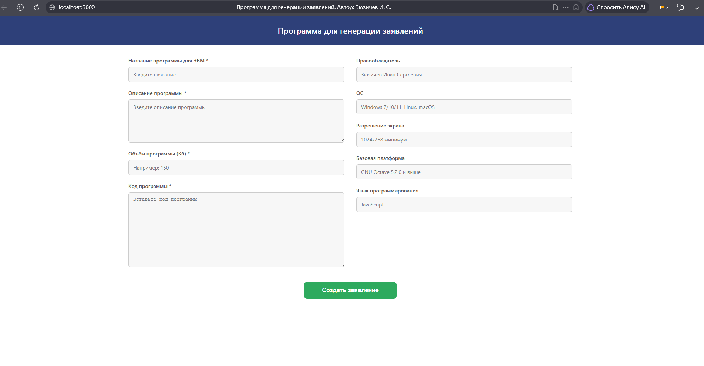

# Generate Docs Patent

Программа для автоматической генерации заявлений на регистрацию программы для ЭВМ в формате DOCX и PDF.



## Запуск

```bash
npm install
npm start
```

Проект откроется на `http://localhost:3000`.

## Обязательные поля

| Поле | Описание |
|------|----------|
| Название программы | Название программы для ЭВМ |
| Описание программы | Описание назначения и функционала |
| Объём программы (Кб) | Размер программы в килобайтах |
| Код программы | Исходный код |

## Необязательные поля

Поля заполняются автоматически значениями по умолчанию, если не введены вручную:

| Поле | Значение по умолчанию |
|------|----------------------|
| Правообладатель | Зюзичев Иван Сергеевич |
| ОС | Windows 7/10/11, Linux, macOS |
| Разрешение экрана | 1024х768 минимум |
| Базовая платформа | GNU Octave 5.2.0 и выше |
| Язык программирования | JavaScript |

## Как работает

1. Заполните обязательные поля
2. При необходимости измените необязательные поля
3. Нажмите «Создать заявление»
4. Выберите папку для сохранения или файлы скачаются автоматически

## Контакты

**Иван Зюзичев** (Frontend/Fullstack Developer)

- Telegram: [@Ivanziz](https://t.me/Ivanziz)
- Email: [ivan.ziuzichev@gmail.com](mailto:ivan.ziuzichev@gmail.com)

> Если ваша компания ищет **frontend-разработчика** / **fullstack-разработчика** — я открыт к предложениям и интересным задачам.

> Готов пройти собеседование, техническое задание и включиться в команду.

---

## © Лицензия

Все права защищены.

Авторское право на исходный код принадлежит **Ивану Зюзичеву**.